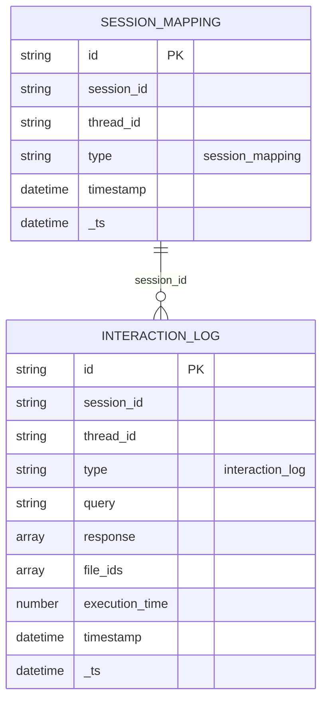

# 🕵️ Clippy Data Detective

Azure Functions (Python) backend for an AI data analyst experience powered by Azure AI Foundry Agents. Identity-based access to Cosmos DB and Blob Storage, with Application Insights telemetry.


## ✨ Features

### UI

- Modern chat UI (frontend typically deployed in Azure Container Apps)
- Markdown rendering with sanitization
- Images proxied via backend route `/api/images/{filename}`

### What it connects to

- Azure AI Foundry Agents API (threads/messages/runs)
- Azure Blob Storage (session files), optional
- Azure Cosmos DB (session/thread mapping), recommended for prod

### Technical

- File uploads (CSV, TXT, PDF, XLSX, JSON, images)
- Session continuity (session_id -> thread_id)
- Application Insights telemetry via OpenTelemetry (backend)

## 🎯 Overview

- Enriches user queries with optional documents (URLs or uploads)
- Returns assistant responses: text, images, executed code snippets
- Supports multipart and JSON request formats

### Request/Response flow

```mermaid
sequenceDiagram
    participant C as Client
    participant F as Function App
    participant S as Session Service
    participant DB as Cosmos DB
    participant AI as Azure OpenAI

    C->>F: POST /api/data-analyst
    F->>S: get_thread_id(session_id)
    S->>DB: Query session mapping
    DB-->>S: thread_id (if exists)
    S-->>F: thread_id or None

    alt New Session
        F->>AI: Create new thread
        AI-->>F: thread_id
    end

    F->>AI: Create message with attachments
    # 🕵️ Clippy Data Detective

    Azure Functions (Python) backend for an AI data analyst powered by Azure AI Foundry Agents. Uses managed identity for Cosmos DB and Blob Storage, with optional telemetry to Application Insights.

    
    

    ## ✨ Features

    ### UI

    - Modern chat UI (frontend typically runs in Azure Container Apps)
    - Markdown rendering with sanitization
    - Images proxied via backend route `/api/images/{filename}`

    ### What it connects to

    - Azure AI Foundry Agents API (threads/messages/runs)
    - Azure Blob Storage (session artifacts) — optional
    - Azure Cosmos DB (session/thread mapping) — recommended for production

    ### Technical

    - File uploads (CSV, TXT, PDF, XLSX, JSON, images)
    - Session continuity (session_id -> thread_id)
    - OpenTelemetry exporter to Application Insights (backend)

    ## 🎯 Overview

    - Enriches user queries with optional documents (URLs or uploads)
    - Returns assistant responses: text, images, and executed code snippets
    - Supports multipart and JSON request formats

    ### Request/Response flow

    ```mermaid
    sequenceDiagram
        participant C as Client
        participant F as Function App
        participant S as Session Service
        participant DB as Cosmos DB
        participant AI as Azure OpenAI

        C->>F: POST /api/data-analyst
        F->>S: get_thread_id(session_id)
        S->>DB: Query session mapping
        DB-->>S: thread_id (if exists)
        S-->>F: thread_id or None

        alt New Session
            F->>AI: Create new thread
            AI-->>F: thread_id
        end

        F->>AI: Create message with attachments
        F->>AI: Run assistant
        AI-->>F: Run completion with response

        F->>S: save_session(session_id, thread_id)
        S->>DB: Upsert session mapping
        F-->>C: Response with content and thread_id
    ```

    ## 📁 Project structure

    ```text
    .
    ├── function_app.py        # HTTP endpoints and telemetry
    ├── models.py              # Chat orchestration and services
    ├── telemetry.py           # Helper for tracing/logging
    ├── requirements.txt       # Python dependencies
    ├── host.json              # Functions host configuration
    ├── images/                # Generated images (runtime-created)
    └── frontend/              # SPA (if present), typically deployed to ACA
    ```

    ## 🚀 Getting started

    ### Prerequisites

    - Python 3.9+
    - Azure Functions Core Tools v4
    - Azure CLI (for auth)

    ### Setup

    1. Install dependencies

    ```bash
    pip install -r requirements.txt
    ```

    2. Authenticate to Azure (for DefaultAzureCredential)

    ```bash
    az login
    ```

    3. Run locally

    ```bash
    func start
    ```

    4. Test

    ```bash
    curl -X POST http://localhost:7071/api/data-analyst \
      -H "Content-Type: application/json" \
      -d '{"session_id": "s1", "query": "Hello"}'
    ```

    ## 🔧 Configuration

    Backend environment variables:

    | Variable | Required | Description |
    |----------|----------|-------------|
    | AIPROJECT_ENDPOINT | ✅ | Azure AI Foundry project endpoint |
    | CHAT_MODEL | ✅ | Model deployment name (e.g., gpt-4o) |
    | AGENT_ID | ⚠️ | Pre-created Agent ID (recommended) |
    | ENABLE_BLOB_STORAGE | ❌ | true to persist artifacts to Blob |
    | DISABLE_LOCAL_FILE_STORAGE | ❌ | true to skip local writes |
    | COSMOS_DB_ENDPOINT | ⚠️ | Cosmos DB endpoint (if using Cosmos) |
    | COSMOS_DB_NAME | ❌ | Cosmos DB database name |
    | COSMOS_CONTAINER_NAME | ❌ | Cosmos DB container name |
    | USE_COSMOS_DB | ❌ | true to require Cosmos (default true) |
    | APPLICATIONINSIGHTS_CONNECTION_STRING | ❌ | Enables OpenTelemetry exporter |

    Authentication uses DefaultAzureCredential (Managed Identity/CLI/etc.). No secrets are hardcoded.

    ## 🌐 API

    ### POST /api/data-analyst

    JSON body:

    ```json
    {
      "session_id": "s1",
      "query": "Your question",
      "documents": [{ "url": "https://example.com/data.csv" }]
    }
    ```

    Multipart form fields: session_id, query, files[]

    Response (success):

    ```json
    {
      "session_id": "s1",
      "thread_id": "...",
      "response": [ { "type": "text", "content": "..." } ],
      "status": "completed",
      "file_ids": ["..."]
    }
    ```

    ### GET /api/images/{filename}

    Serves generated assets with validation. Supported: .png, .jpg, .jpeg, .svg, .gif. When blob persistence is enabled, include `session_id` as a query param to proxy from Blob.

    ## 🔒 Security and CORS/CSP

    - CORS: allow your frontend origin in the Function App CORS settings
    - CSP: if using the provided frontend, connect-src should include your Function App URL
    - Files validated by extension; directory traversal is blocked

    ## 📊 Monitoring

    - Backend telemetry via Azure Monitor OpenTelemetry (enabled by `APPLICATIONINSIGHTS_CONNECTION_STRING`)
    - Spans and metrics for request count and latency

    ## 📝 License

    MIT
```

### GET /images/{filename}

Serves generated images (PNG files only).

## 🏛️ Data Storage

### Session Management



### Document Types

1. **Session Mapping**: Links session IDs to OpenAI thread IDs
2. **Interaction Log**: Stores detailed conversation history with timing and file metadata

## 🛠️ Development

### Local Development

```bash
# Install dependencies
pip install -r requirements.txt

# Set up environment
cp .env.example .env
# Edit .env with your credentials

# Run locally
func start

# Run tests
python -m pytest tests/
```

### Testing

```bash
# Test Cosmos DB connectivity
python test_fixed_cosmos.py

# Test conversation continuity
python test_conversation_continuity.py

# Interactive testing
python interactive_test.py
```

## 🚢 Deployment

### Azure Deployment

1. **Create Azure Resources**
   ```bash
   # Create resource group
   az group create --name rg-dataanalyst --location eastus
   
   # Create Function App
   az functionapp create \
     --resource-group rg-dataanalyst \
     --consumption-plan-location eastus \
     --runtime python \
     --runtime-version 3.9 \
     --functions-version 4 \
     --name your-function-app-name \
     --storage-account yourstorageaccount
   ```

2. **Deploy Function**
   ```bash
   func azure functionapp publish your-function-app-name
   ```

3. **Configure Application Settings**
   ```bash
   az functionapp config appsettings set \
     --name your-function-app-name \
     --resource-group rg-dataanalyst \
     --settings \
     AZURE_API_KEY="your-openai-key" \
     AZURE_API_ENDPOINT="your-openai-endpoint" \
     COSMOS_DB_ENDPOINT="your-cosmos-endpoint"
   ```

## 🔒 Security

- Uses Azure Active Directory authentication for Cosmos DB
- API keys stored in secure application settings
- File uploads validated for type and size
- Generated images served with security checks
- No sensitive data logged in plaintext

## 📊 Monitoring

The application includes comprehensive logging for:
- Request/response timing
- Cosmos DB operation metrics
- OpenAI API usage
- Error tracking and debugging
- Session interaction history

## 🐛 Troubleshooting

### Common Issues

1. **Cosmos DB Timeout Errors**
   - Solution: Timeout configurations optimized for cross-partition queries
   - Retry logic implemented with exponential backoff

2. **OpenAI API Rate Limits**
   - Solution: Built-in retry mechanisms
   - Monitor usage in Azure portal

3. **File Upload Issues**
   - Check file size limits (default: 10MB per file)
   - Verify file type restrictions

### Debug Mode

Enable detailed logging:

```json
{
  "logging": {
    "logLevel": {
      "default": "Information"
    }
  }
}
```

## 📝 License

This project is licensed under the MIT License - see the LICENSE file for details.

## 🤝 Contributing

1. Fork the repository
2. Create a feature branch
3. Commit your changes
4. Push to the branch
5. Create a Pull Request

## 📞 Support

For issues and questions:
- Check the troubleshooting section
- Review the logs for error details
- Open an issue on GitHub
