# Clippy Data Detective — Architecture & Flow Diagrams

## 1. High-Level System Architecture

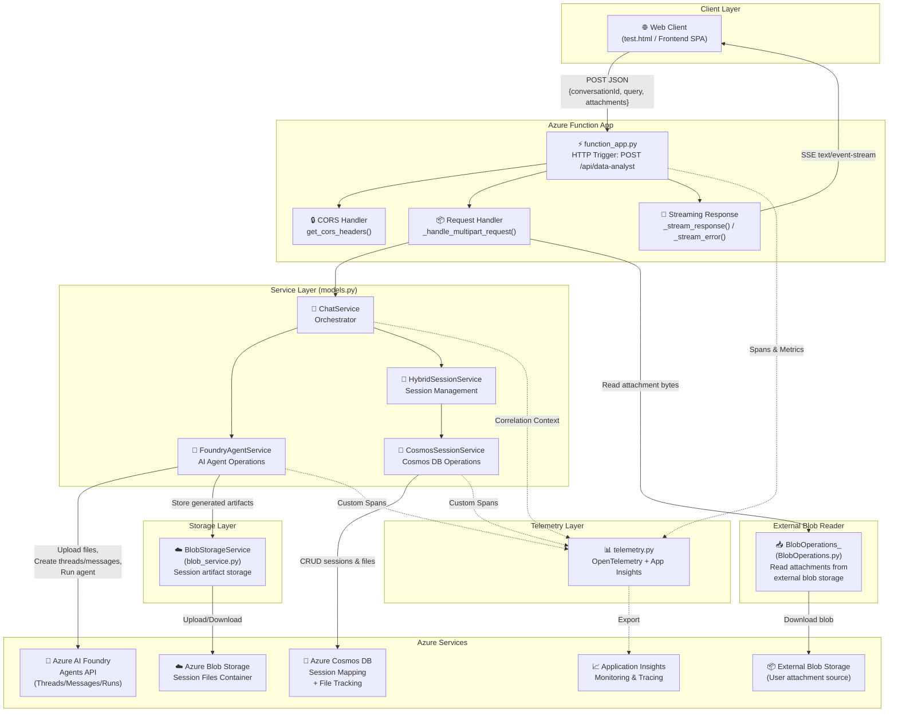

---

## 2. Complete Request Processing Sequence

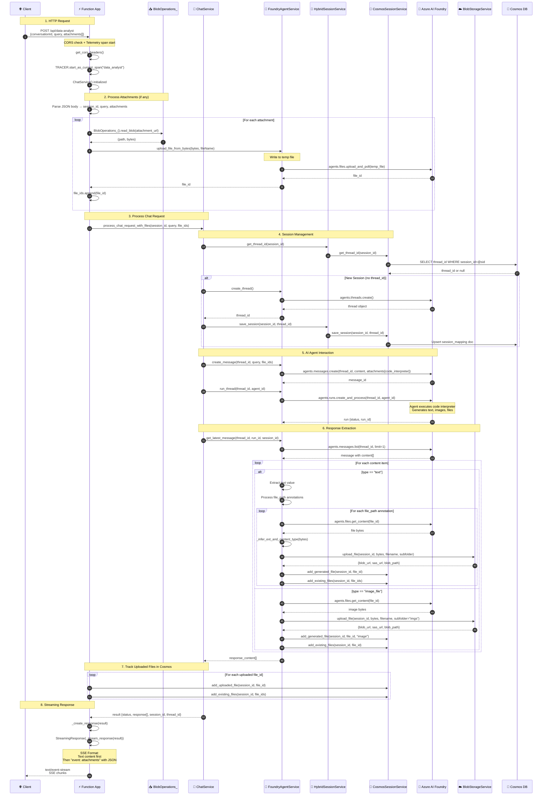

---

## 3. Class Diagram

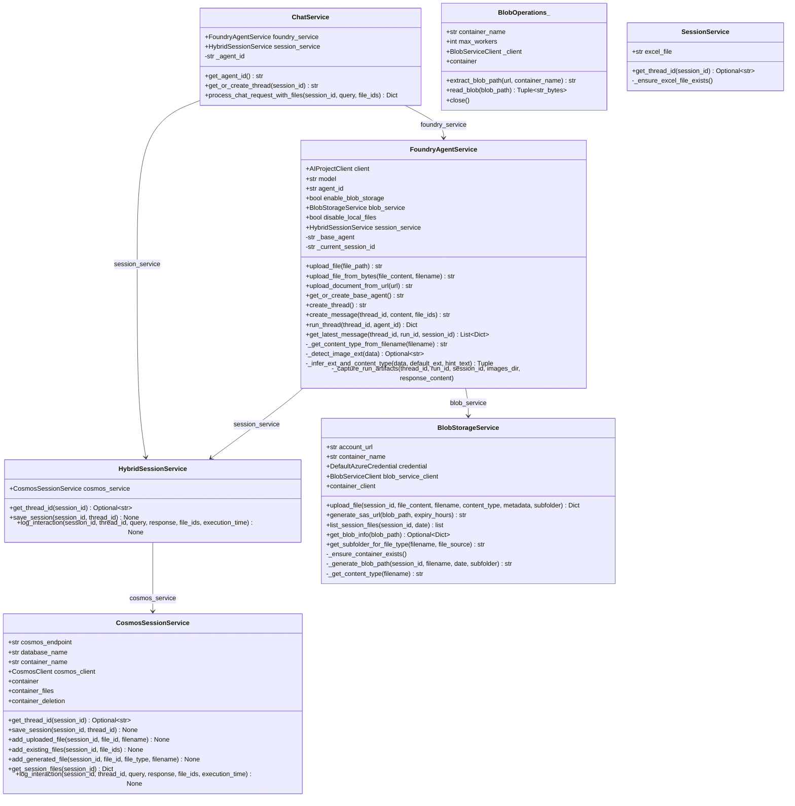

---

## 4. File Processing & Artifact Classification Flow

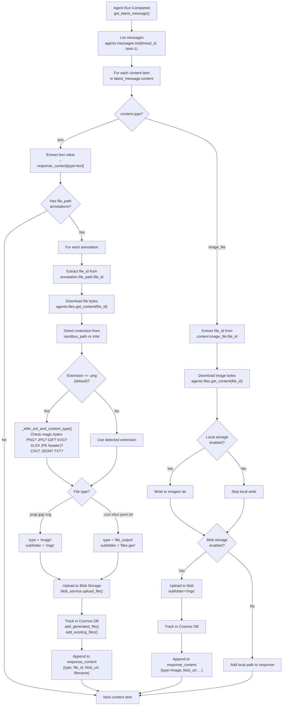

---

## 5. Session Management Flow

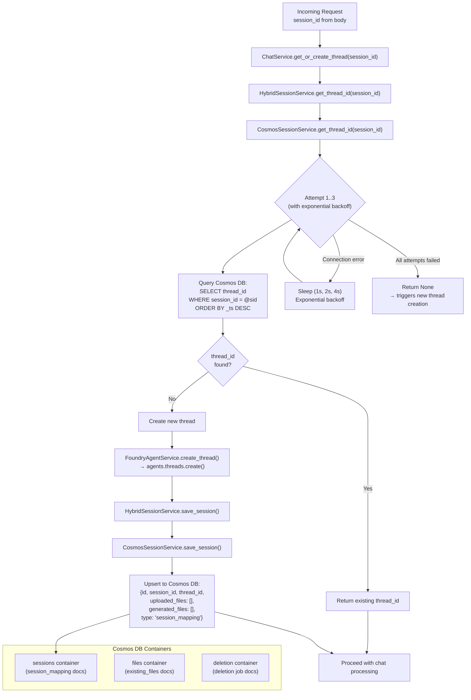

---

## 6. Blob Storage Organization

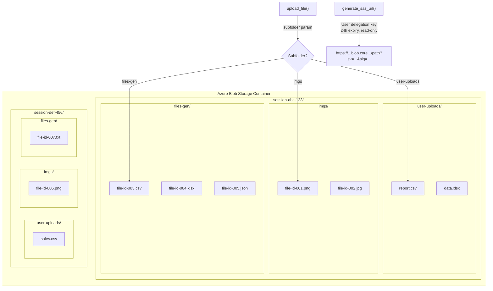

---

## 7. Streaming Response Format (SSE)

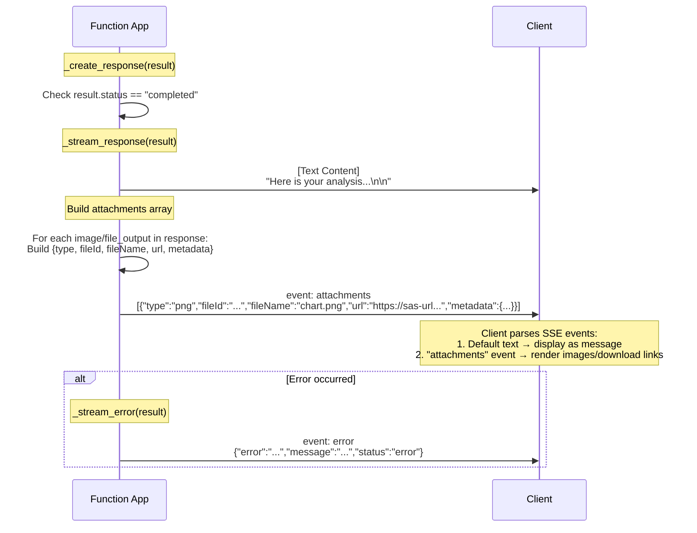

---

## 8. Telemetry & Observability Flow

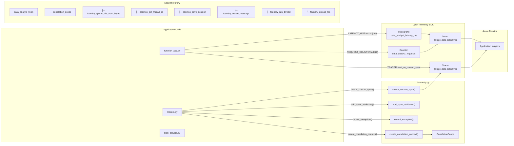

---

## 9. Attachment Upload Pipeline (Detailed)

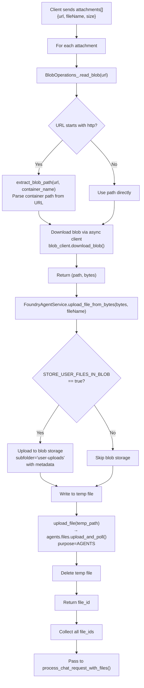

---

## 10. Cosmos DB Document Schema

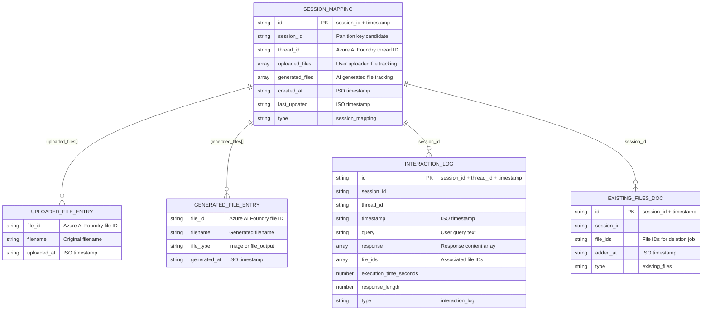

---

## 11. End-to-End Data Flow Summary

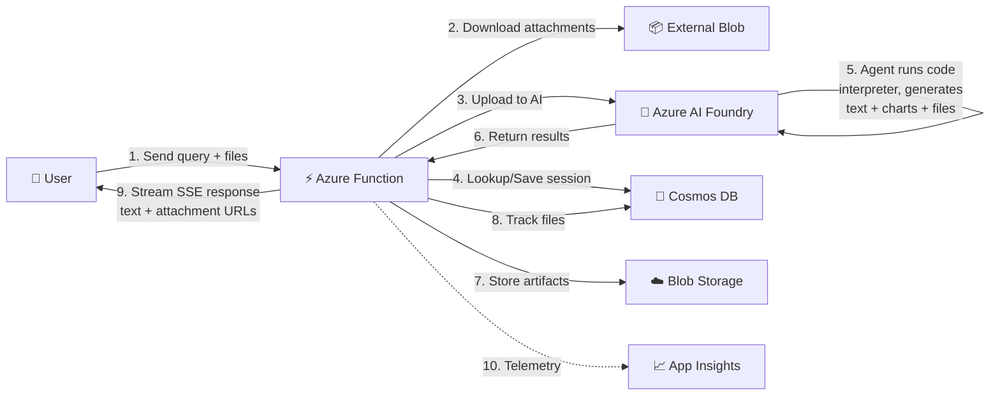
